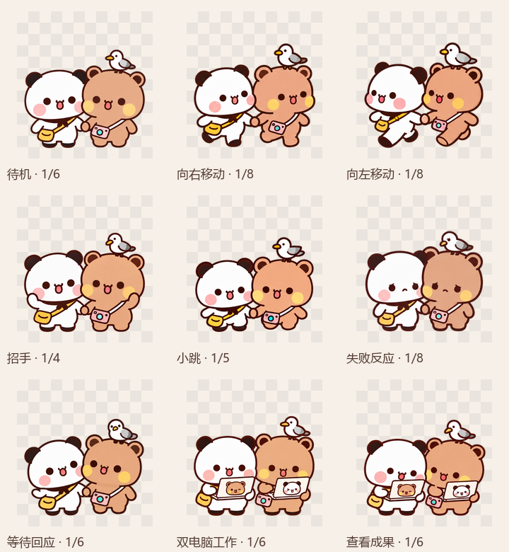
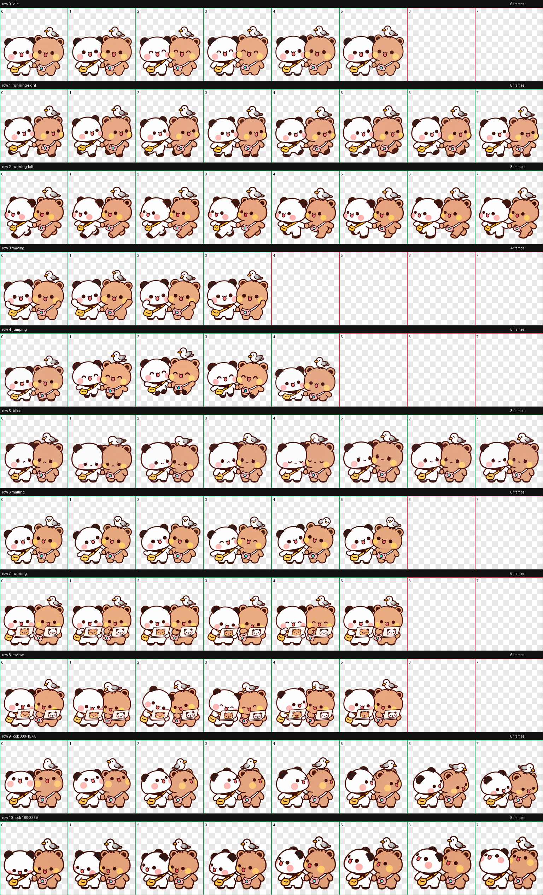

# 牵手海鸥一二布布

一二斜挎小黄包，布布背着粉色相机，小海鸥站在布布头顶。两只小熊一起牵手、招手、小跳，工作时各自拿出一台小电脑，电脑背面贴着对方的 wink 贴纸。

为支持 v2 虚拟宠物的 **Codex 桌面客户端**制作，包含 **9 组动作、16 个注视方向，共 73 个有效帧**。

| 牵手待机 | 一起招手 | 双电脑工作 |
| --- | --- | --- |
|  |  |  |

## 下载与安装

两个系统使用同一套 V3 笑眼动画。待机为睁眼与眯眼笑交替，小跳腾空时两只熊一起眯眼笑。

### Windows 安装

**[下载 Windows 安装包](https://github.com/Touyuanyuan/codex-yier-bubu-seagull-pet/releases/download/v1.0.0/codex-yier-bubu-seagull-pet-v1.0.0-windows.zip)** · [版本发布页](https://github.com/Touyuanyuan/codex-yier-bubu-seagull-pet/releases/tag/v1.0.0)

1. 确认已安装 Codex，设置里能看到「Mini 与虚拟宠物」。
2. 下载 `codex-yier-bubu-seagull-pet-v1.0.0-windows.zip`，选择「全部解压」。
3. 打开解压后的文件夹，双击 **`install.cmd`**，等待安装完成提示。
4. 回到 Codex：**设置 → Mini 与虚拟宠物 → 点击「创建虚拟宠物」左侧的小刷新图标 ↻ → 选择「牵手海鸥一二布布」**。

安装脚本无需 Python、Node.js 或管理员权限，运行时不下载文件。不要直接在压缩包预览窗口里运行脚本。

默认安装到 `%USERPROFILE%\.codex\pets\yier-bubu-handholding-seagull`；设置了 `CODEX_HOME` 时使用其 `pets` 目录。脚本只复制本宠物的配置和图集，不会自动更改当前选择。重复安装会先把同 ID 的旧文件备份到 Codex 用户目录下的 `pet-backups`。

如需指定 Codex 用户目录：

```powershell
powershell -NoProfile -ExecutionPolicy Bypass -File .\install.ps1 -CodexHome "D:\CodexData"
```

### Mac 安装

**[下载 Mac 安装包](https://github.com/Touyuanyuan/codex-yier-bubu-seagull-pet/releases/download/v1.0.0/codex-yier-bubu-seagull-pet-v1.0.0-macos.zip)** · [详细安装说明](docs/INSTALL-MACOS.md)

1. 下载 Mac ZIP，解压后打开文件夹。
2. 双击 **`install.command`**，等待「牵手海鸥一二布布安装完成」。
3. 回到 Codex：**设置 → Mini 与虚拟宠物 / Pets → 刷新 ↻ → 选择「牵手海鸥一二布布」**。

不需要管理员权限、Python、Node.js 或 Homebrew。默认安装到 `~/.codex/pets/yier-bubu-handholding-seagull/`，也支持 `CODEX_HOME`。不同旧版本会先备份到 `pet-backups` 再更新。

双击打不开时，在 Mac「终端」输入 `/bin/bash `，将 `install.command` 拖进去，再按回车。

## 预览与动作

完整解压后，双击 **`preview.html`**，可离线切换动作、暂停、慢速、深浅背景和 16 个注视方向。预览时序用于展示，Codex 内的实际播放速度由客户端控制。

9 组动作：待机、向右移动、向左移动、招手、小跳、失败反应、等待回应、双电脑工作、查看成果。

- [九组动作预览视频](docs/all-states.mp4)
- [小跳预览](docs/jumping.gif)
- [16 个注视方向](docs/look-directions.gif)



<details>
<summary>查看完整逐帧动作总图</summary>



</details>

## 在线安装入口

下载包中的 `install-in-codex.url` 使用 `codex://pets/install` 协议，指向本仓库 `v1.0.0` 标签下的 HTTPS 图集。也可查看 `install-link.txt`。

该入口需要客户端支持此协议，并可能要求确认打开 Codex、确认安装。若入口无法使用，按上面的 Windows 或 Mac 离线安装步骤操作。

## 文件与格式

```text
pet/
  pet.json
  spritesheet.webp
docs/                  动作预览与逐帧总图
preview.html           离线交互预览
install.cmd            Windows 双击入口
install.ps1            Windows 安装脚本
install.command        Mac 双击入口
install.sh             Mac 安装脚本
tools/build-release.py  构建 Windows 与 Mac 安装包
```

图集采用 v2 格式：1536 × 2288 像素，8 列 × 11 行，每格 192 × 208 像素。9 组动作占 57 帧，注视方向占 16 帧，其余格透明。两只熊作为一个整体桌宠显示，保持图像原始比例。

两个安装包都包含相同的透明图集与配置。安装脚本离线复制文件，保留旧版备份。

构建发行包只需要 Python 3.9+：

```text
python tools/build-release.py
```

压缩包写入仓库同级的 `artifacts` 文件夹。生成源图、私人会话和原作者参考图不在发行包中。

## 卸载

先在 Codex 中选择其他宠物或「无」，再删除用户目录下的 `pets/yier-bubu-handholding-seagull` 文件夹，返回设置刷新。

同系列：[小黄包一二](https://github.com/Touyuanyuan/codex-yier-yellow-bag-pet) · [相机布布](https://github.com/Touyuanyuan/codex-bubu-pet)。

## 来源与许可

角色原作者为 **黄小B**。本项目的宠物动画由 AI 辅助生成并整理。代码采用 [MIT 许可](LICENSE)，角色与美术素材范围另见 [ASSET-NOTICE.md](ASSET-NOTICE.md)；参考来源见 [CREDITS.md](CREDITS.md)。
